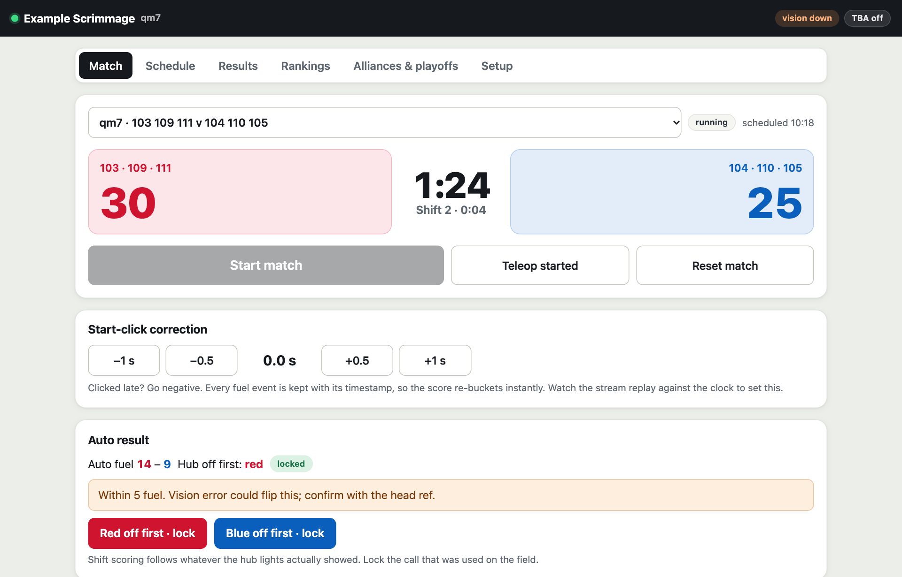
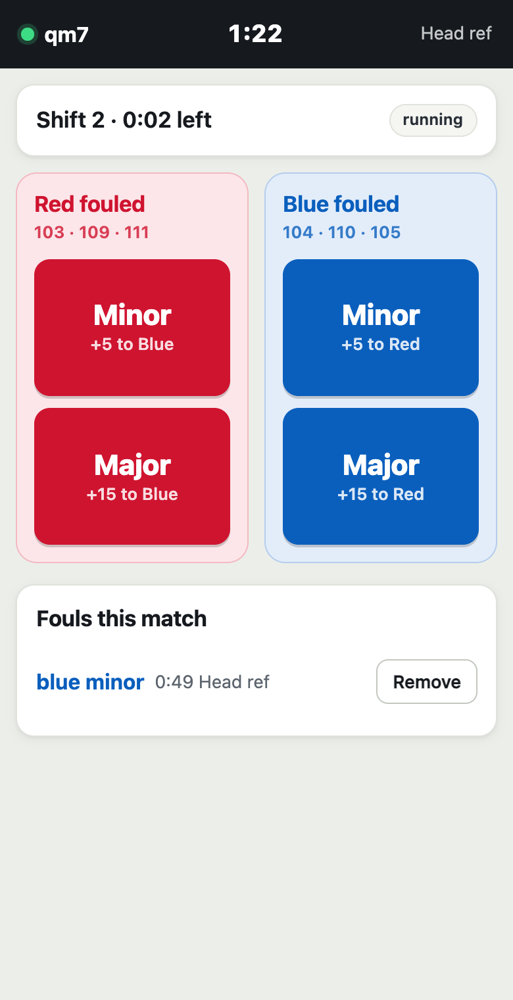
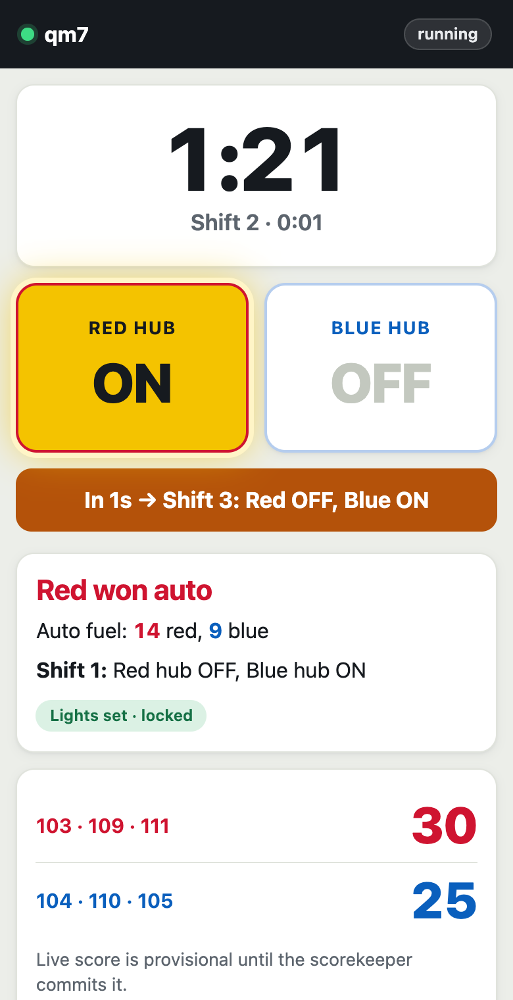
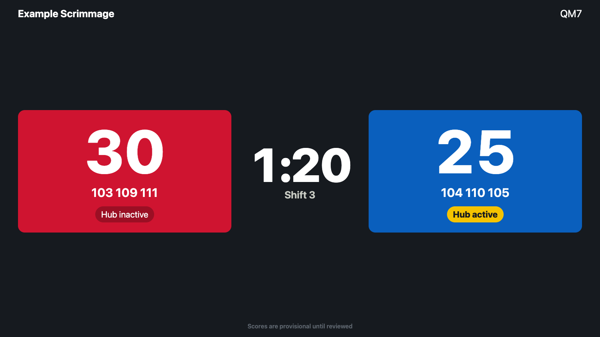
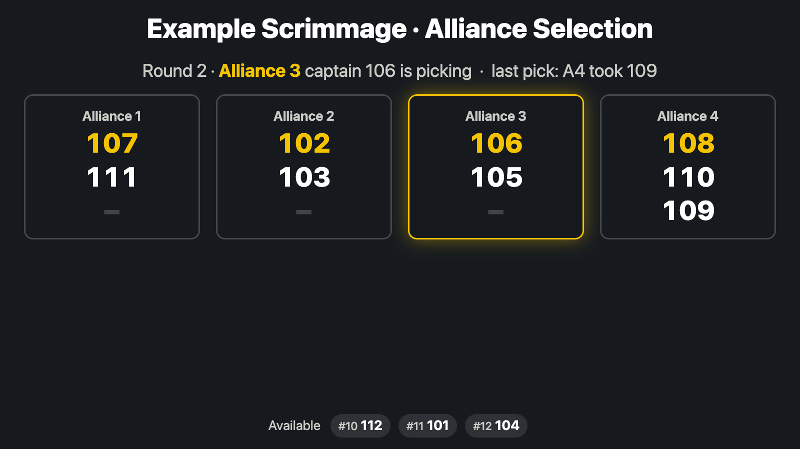

# Watchtower FMS: offseason field management with vision scoring

A free, open-source field management system for **FRC offseason events and scrimmages** playing the 2026 game **REBUILT** (or the 2025 game **REEFSCAPE**, scored by hand). It runs on one laptop on the venue WiFi:

- **Two hub cameras count fuel automatically** with a YOLO model you supply (no weights ship with this repo), or the scorekeeper types counts per period with no cameras at all.
- **Refs log fouls from their phones**, and the **emcee's phone says which hub lights to switch** and when.
- **The scorekeeper** runs matches, reviews and corrects scores, and runs **live alliance selection** that shows on the field display.
- **Quals schedule generator**, **rankings**, and a **4-alliance double-elimination playoff** with best-of-3 finals.
- **The Blue Alliance**: schedule, scores, rankings, alliances and match videos are pushed automatically, and queue up while the venue is offline.
- **Field display / OBS overlay** for the audience and the stream.

It doesn't control robots or talk to driver stations. It's the scoring, timing and event-management layer around a field you run by hand.

Built for the 10th Street Showdown (October 2026) and shared so other teams can run their own offseason events with it.

| Scorekeeper | Ref phone | Emcee phone |
|---|---|---|
|  |  |  |

| Field display | Live alliance selection |
|---|---|
|  |  |

---

## Use the website (recommended)

**[watchtower.systemoverload.org](https://watchtower.systemoverload.org)**. No clone, no config files.

1. **Sign up and create your event** (game, name, date, teams; all but the game can change later). Pick REBUILT (2026)
   or REEFSCAPE (2025, see [REEFSCAPE events](#reefscape-events)); BIOCORE (2027) is listed but can't be picked yet.
2. **Copy the launch command** from your event's page and paste it into Terminal (Mac/Linux) or
   PowerShell (Windows) on the scorekeeper's laptop:
   ```bash
   curl -fsSL https://watchtower.systemoverload.org/run/<your event's token> | sh                # FMS + hub cameras
   curl -fsSL https://watchtower.systemoverload.org/run/<your event's token> | sh -s -- --mock  # fake fuel instead
   ```
   The first run installs Watchtower into `~/Watchtower` (Python too, via [uv](https://docs.astral.sh/uv/),
   if the laptop has no Python 3.10+, and OpenCV for the cameras). Later runs start in seconds;
   `~/Watchtower/start <event> [--mock|--no-vision]` also works. It prints the phone address and PINs and
   opens `/control`. Ctrl+C stops it.
3. **Set everything else in `/control` → Setup**: event name, date and teams, TBA keys, PINs, the field
   system's IP (bioarena). Or set them on the website before event day.
4. **Hub cameras** (optional): plug them into the laptop and follow `/control` → Setup → **Cameras**: Find
   cameras, give each hub its camera, click around the hub's opening, then Calibrate (drop 20+ balls in,
   type how many). The counter ships with Watchtower; there is no model or plugin to install. No camera is
   opened until you pick one. See [Hub cameras from Setup](#hub-cameras-from-setup).

**Your event runs on your laptop, not on the website.** Matches, fuel and scores never leave it, phones
talk to it over the venue WiFi, and it keeps working if the venue's internet drops. When there is internet,
the laptop syncs its Setup settings with the website every 15 s (newest edit wins, per setting) and
reports its status, so the event page shows whether it's running, the current match and the address phones
open. Phones can also open `watchtower.systemoverload.org/e/<event>` to be linked to your laptop.

Treat the launch command like a password: it carries the event's PINs and TBA keys. **New launch command**
on the event page cuts the old one off.

Running your own copy of the website instead: see [Hosting the website](#hosting-the-website).

## Quick start (no cameras, about 5 minutes)

```bash
git clone https://github.com/<owner>/watchtower-fms.git && cd watchtower-fms
python3 -m venv .venv && source .venv/bin/activate      # Windows: see Setup
pip install -r requirements.txt
python -m fms.init                     # creates config/event.yaml with random PINs (printed once)
```

Set `event.name`, `event.date` and `event.teams` (your team numbers) in `config/event.yaml`, or later in `/control` → Setup. Then:

```bash
pip install -r vision/requirements.txt     # only needed for real cameras; skip for a first look
./run.sh ../config/vision.mock.yaml        # FMS + fake fuel; or: python -m fms.server
```

Open `http://localhost:8000` on the laptop, or `http://<laptop-ip>:8000` on a phone on the same WiFi. Pick **Scorekeeper**, log in with the control PIN, generate a schedule, and play a match. Everything below is detail.

---

## Contents

1. [Use the website](#use-the-website-recommended)
1. [Quick start](#quick-start-no-cameras-about-5-minutes)
1. [Architecture](#architecture)
2. [Repo layout](#repo-layout)
3. [Setup: macOS, Windows, Linux](#setup)
4. [Configuration](#configuration)
5. [Running](#running)
6. [Phones and networking](#phones-and-networking)
7. [Before the event: schedule](#before-the-event-schedule)
8. [Running a match](#running-a-match)
9. [Rankings, alliance selection, playoffs](#rankings-alliance-selection-playoffs)
10. [Vision: plugging in models](#vision-plugging-in-models)
11. [The Blue Alliance](#the-blue-alliance)
12. [Livestream and match videos](#livestream-and-match-videos)
13. [Data, backups, resetting](#data-backups-resetting)
14. [Testing](#testing)
15. [Working on this with AI agents](#working-on-this-with-ai-agents)
16. [Event-day checklist](#event-day-checklist)
17. [Troubleshooting](#troubleshooting)
18. [Limitations and things to verify](#limitations-and-things-to-verify)
19. [Contributing, license, credits](#contributing-license-credits)

---

## Architecture

Two independent processes. The FMS never touches the model, and vision never touches scoring rules.

```
 hub cam RED ──┐                                          ┌─ /ref      ref phones: fouls
               ├─ vision/run_vision.py ─(t, hub, n)──▶ FMS server ──┼─ /emcee    emcee phone: auto result, hub light cues
 hub cam BLUE ─┘   counter plugin + YOLO     HTTP      FastAPI    ├─ /control  scorekeeper laptop: start, review, commit
                                                     + SQLite   ├─ /display  field TV / OBS overlay
 stream cam ──▶ OBS ──▶ YouTube live                     │       └─▶ TBA outbox (retries until delivered)
```

**Vision only reports timestamped fuel events:** which hub, when, and how many. It knows nothing about periods, shifts or points.

**The FMS decides what each ball is worth.** It builds the match timeline from the scorekeeper's start click, then checks every fuel event against it: which period it fell in, whether that alliance's hub was active, and whether it landed inside the 3-second grace window after a hub shut off. That gives you three things:

- **Start-click error is fixable after the match.** Shift the timeline ±0.5 s and every ball re-buckets instantly.
- **Vision can be swapped, restarted or replaced** (new model, offline recount) without touching the FMS.
- **The FMS works with no vision at all.** The scorekeeper types fuel counts per period in review.

Everything lives in SQLite, so a crash or restart loses nothing. Phones get live state over one websocket and keep their own clock in sync with the server.

---

## Repo layout

```
fms/
  server.py        API, websocket, match engine (start, auto decision, review, commit)
  game.py          REBUILT timeline + scoring: pure functions, all values from config
  reefscape.py     REEFSCAPE timeline + scoring (hand-entered counts): pure functions, all values from config
  schedule.py      qual schedule generator + CSV import
  bracket.py       4-alliance double elimination + rankings
  tba.py           TBA trusted API client with persistent outbox
  store.py         SQLite persistence
  config.py        config loader, defaults, PIN checks
  settings.py      live settings (/control -> Setup) on top of event.yaml; newest-wins merge
  cloud.py         optional sync with the website (settings + status; never matches)
  init.py          first-run setup: python -m fms.init
  static/          control / ref / emcee / display pages (vanilla JS, no CDN)
vision/
  run_vision.py    cameras -> counter -> FMS; records match video; takes feeds, calibration and
                   Setup -> Cameras (camera, outline, drop test, pictures) from the FMS
  hubcounter/      the colour counter (built-in `colour`), copied from YOLOv26-FRC-Model (MIT)
  hubsetup.py      a hub's Setup -> Cameras entry -> its counter config
  dropfit.py       the drop test: fit the one-ball size to the number of balls dropped
  scaler.py        counts-per-ball calibration
  counters/        zone, linecross, mock, base interface
  rescore.py       recount a recorded match with a new model
  pick_roi.py      draw the hub region on a camera frame
  vconfig.py       vision config loader (takes vision_key from event.yaml)
  models/          put weights here (gitignored)
config/
  event.example.yaml   template: event, PINs, TBA, game rules (committed)
  vision.example.yaml  template: cameras, ROIs, counter, weights (committed)
  vision.mock.yaml     fake fuel for rehearsal (committed)
  event.yaml           your event; created by fms.init, gitignored
  vision.yaml          your cameras; created by fms.init, gitignored
website/           watchtower.systemoverload.org: sign-up, events, launch scripts, settings sync
deploy/            build.sh (the download), deploy.sh + systemd unit + Caddy block for the website
launch.py          run one event's FMS + hub cameras (or --mock / --no-vision) from its folder; what the launch command runs
.github/workflows/authors.yml  checks every commit credits the repo owner
docs/screenshots/  images used in this README
tests/             hand-computed scoring, schedule, bracket, selection, setup tests
run.sh             start FMS + vision together (runs fms.init on first use)
CHANGELOG.md       what changed in each version
CLAUDE.md          project context for AI coding agents (AGENTS.md links to it)
LICENSE            MIT
```

---

## Setup

You need Python 3.12–3.14 and git. The FMS alone needs very little. The vision stack (PyTorch, Ultralytics, OpenCV) is about 1 GB.

### macOS (recommended; event laptop)

```bash
brew install python@3.12 git          # or use python.org Python 3.12–3.14
git clone https://github.com/<owner>/watchtower-fms.git
cd watchtower-fms
python3.12 -m venv .venv
source .venv/bin/activate
pip install -r requirements.txt -r vision/requirements.txt
chmod +x run.sh
python -m fms.init                    # creates config/event.yaml + config/vision.yaml, prints PINs
python -m pytest -q                   # expect: 37 passed
python -c "import torch, cv2, ultralytics; print(torch.__version__, torch.backends.mps.is_available())"
```

The last line should end in `True`, which means Apple Silicon GPU (MPS) inference is available. The first import can take up to a minute.

### Windows

```powershell
winget install Python.Python.3.12 Git.Git
git clone https://github.com/<owner>/watchtower-fms.git
cd watchtower-fms
py -3.12 -m venv .venv
.venv\Scripts\Activate.ps1            # if blocked: Set-ExecutionPolicy -Scope CurrentUser RemoteSigned
pip install -r requirements.txt -r vision\requirements.txt
python -m fms.init
python -m pytest -q
```

- `run.sh` is a bash script. Use two terminals instead (see [Running](#running)), or run it from Git Bash or WSL.
- NVIDIA GPU: install the CUDA build of PyTorch from pytorch.org *before* `vision/requirements.txt`. Otherwise inference runs on the CPU, which is too slow for two live cameras.
- Allow Python through Windows Defender Firewall on **Private** networks when prompted.

### Linux

```bash
sudo apt install python3 python3-venv git      # Debian/Ubuntu
git clone https://github.com/<owner>/watchtower-fms.git
cd watchtower-fms
python3 -m venv .venv
source .venv/bin/activate
pip install -r requirements.txt -r vision/requirements.txt
chmod +x run.sh
python -m fms.init
python -m pytest -q
```

- For camera access, add yourself to the `video` group: `sudo usermod -aG video $USER`, then log out and back in.
- For an NVIDIA GPU, install the matching CUDA PyTorch build first.
- If `ufw` is on: `sudo ufw allow 8000/tcp`.

### FMS only (no vision)

To try the pages or run scoring by hand, install just `requirements.txt` and skip `vision/requirements.txt`.

---

## Configuration

Your event's settings live in two gitignored files, so your PINs and event details never end up in git:

- `python -m fms.init` copies `config/event.example.yaml` → `config/event.yaml` and `config/vision.example.yaml` → `config/vision.yaml`. It fills in three random 6-digit PINs and a random vision key, and prints the PINs. It never overwrites an existing file. `run.sh` runs it automatically the first time.
- The server won't start if `config/event.yaml` is missing, a PIN is still `CHANGE-ME` or blank, the control PIN is the same as the ref or emcee PIN, or `display.red_side` isn't `left` or `right`.

### Live settings: `/control` → Setup

Everything a team needs to change is in **Setup**, applied at once with no restart. `event.yaml` is only the
starting point; a Setup value wins over it, and **Use event.yaml** puts one back.

| Setup panel | Settings |
|---|---|
| **Event** | name, date, UTC offset, TBA event key, first match, cycle, teams |
| **The Blue Alliance** | Auth ID, secret (never shown again after saving), Send to TBA on/off |
| **Field system (bioarena)** | the field's IP and UDP port; shows this laptop's IP to enter in the field's counter setting |
| **Cameras** | per hub: camera (USB index, or a network camera / video file), the outline drawn on its live picture, and the drop-test calibration ([Hub cameras from Setup](#hub-cameras-from-setup)) |
| **Vision & calibration** | per hub: status, counts per ball, and a **Calibrate** button (for counters other than the built-in colour one) |
| **PINs** | scorekeeper, ref, emcee; **Random new PINs**. A changed PIN logs out every device using it |

They're stored in SQLite (`kv` key `settings`) and survive restarts and **Wipe everything**. After 10 wrong
PINs in a minute, logins wait out the rest of that minute.

**Calibration.** For hubs set up in **Cameras**, the drop test there is the calibration: it sets the
one-ball size the colour counter divides by, and puts counts per ball back to 1. For any other counter, a
counter that sees one ball as several counts is corrected per hub with **counts per ball**: the vision
process divides that hub's count by it before the FMS and the field feed see it. To measure it, start the
cameras, press **Calibrate** in Vision & calibration, drop some balls in, enter how many, and press **Done**.
The raw count is kept beside the corrected one. A new value applies from the next ball; already stored fuel
isn't changed (fix a match in review if needed).

### `config/event.yaml`

| Section | Key | What it does |
|---|---|---|
| `event` | `name`, `date`, `utc_offset_hours` | Display name; date and offset produce TBA match times (PDT = −7) |
| | `tba_event_key` | e.g. `2026xxxx`, from the TBA event URL |
| | `teams` | Team numbers at the event. At least 6 to build a schedule, at least 12 for live alliance selection (4 alliances of 3) |
| | `qual_start`, `cycle_min` | Schedule clock: first match and match-to-match time |
| | `lunch`, `lunch_end` | The lunch break (default 12:00–13:00). By default quals should finish by `lunch`, and the preview warns if they don't |
| | `quals_after_lunch`, `day_end` | `true`: match times skip the lunch break and quals continue after it until `day_end` (default 17:00), for an event that's only quals or has playoffs later. Default `false`. The Schedule tab can switch this per schedule |
| `display` | `red_side` | `left` or `right` (default `right`): which side of every page red is drawn on. Screen order only. `/control` → Setup → **Field sides** overrides it live. Older configs without this key get `right`; earlier versions always drew red on the left, so set `left` to keep that |
| `server` | `port` | Default 8000. Don't change it after phones have saved the pages |
| | `pins.control / ref / emcee` | Generated by `fms.init`. Give each one only to that role: anyone on the WiFi can load the pages |
| | `vision_key` | Shared secret between the FMS and vision. Vision reads it from this file, so you don't copy it anywhere |
| `tba` | `enabled` | Off while rehearsing (see [TBA](#the-blue-alliance)) |
| | `send_score_breakdown` | Off by default; totals-only is always accepted |
| `event` | `game` | `rebuilt` (default) or `reefscape`. Set when the event is made; the `game:` section must then hold only that game's keys (defaults for both are `GAME_RULES` in `fms/config.py`) |
| `game` | all | Every timing and point value. **Verify against the manual** |

TBA credentials don't go in this file. See [The Blue Alliance](#the-blue-alliance).

### `config/vision.yaml`

| Key | What it does |
|---|---|
| `fms_url` | Where vision sends events (`http://127.0.0.1:8000` on the same laptop) |
| `vision_key` | Optional. Leave it out to use `server.vision_key` from `config/event.yaml` |
| `record_dir` | Raw hub video per match; `""` disables recording |
| `defaults.counter` | `zone`, `linecross`, `mock`, or `"module:Class"` |
| `defaults.weights` | Path to the model, e.g. `models/fuel_best.pt` |
| `hubs.red/blue.source` | Camera index (`0`, `1`), a video file path, or an `rtsp://` URL |
| `hubs.red/blue.roi` | `[x, y, w, h]` of the hub opening in full-resolution pixels |
| `feeds` | Optional list of field systems to stream live counts to (`name`, `host`, `port`, `bind`, `heartbeat_s`). See [Feeding a field system](#feeding-a-field-system-bioarena). A field set in `/control` → Setup replaces these (and `--feed`) live |

Any key can be set under `defaults` or overridden per hub.

---

## Running

### One command (macOS / Linux)

```bash
source .venv/bin/activate
./run.sh                                     # real cameras (config/vision.yaml)
./run.sh ../config/vision.mock.yaml          # mock fuel: no model or cameras
./run.sh ../config/vision.yaml --preview     # camera windows with detections drawn
```

Ctrl+C stops both processes. On macOS, `run.sh` also keeps the laptop awake.

### Two terminals (event day, and Windows)

Two terminals let you restart vision, for example to swap models, without touching the FMS.

```bash
# terminal 1 (repo root)
source .venv/bin/activate          # Windows: .venv\Scripts\Activate.ps1
source tba_secrets.sh              # only if TBA is enabled (Windows: see TBA section)
caffeinate -dimsu python -m fms.server    # macOS; elsewhere just: python -m fms.server

# terminal 2
cd vision
source ../.venv/bin/activate
python run_vision.py --config ../config/vision.yaml --preview
```

In `--preview`, press `q` in a camera window to quit vision.

### Rehearse with no model

`./run.sh ../config/vision.mock.yaml` emits random fuel into both hubs. Everything else is real: refs, emcee, commits, rankings, playoffs. Use it to train volunteers before the model is ready. If `config/vision.yaml` has `feeds:`, mock vision streams its fake counts to those field systems too (e.g. bioarena), so you can rehearse the field link without cameras; add `feeds: []` to `vision.mock.yaml` to keep a rehearsal off the field.

---

## Phones and networking

Everyone joins the **venue WiFi**: the scorekeeper laptop, ref phones and the emcee phone. Phones open the laptop's address:

| OS | Find the laptop's IP |
|---|---|
| macOS | `ipconfig getifaddr en0` (try `en1` if blank) |
| Windows | `ipconfig` → "IPv4 Address" of the WiFi adapter |
| Linux | `hostname -I` |

Then on each phone, open `http://<ip>:8000/ref` (or `/emcee`) and choose Share → **Add to Home Screen**. It opens like an app.

- **`localhost` / `127.0.0.1` only works on the laptop itself.** On a phone it means the phone.
- **Type `http://` and `:8000`.** Some phone browsers try `https://` otherwise, and that fails.
- **The IP changes per network,** so recheck it at the venue. To get a name that never changes on macOS:
  ```bash
  sudo scutil --set LocalHostName watchtower-fms
  ```
  Then phones use `http://watchtower-fms.local:8000/ref`. iPhones resolve `.local` reliably, some Android phones don't, and some managed networks block it. Keep the IP as a backup.
- **Client isolation.** Some networks, especially guest ones, block phones from reaching the laptop. Test at the venue: if `http://<ip>:8000` loads on the laptop but not a phone, check the laptop firewall first. If it still fails, ask the venue for a non-guest network or to disable "client/AP isolation".
- **Phones must stay on WiFi.** Cellular can't reach a local IP. On iPhone, turn off Wi-Fi Assist (Settings → Cellular), and no VPNs.
- **Internet is only needed for TBA.** Scoring works fully offline, and TBA updates queue until internet returns.

PINs are in `config/event.yaml` (`fms.init` printed them). Changing one there takes effect on the next server restart; phones then ask for the new PIN.

---

## Before the event: schedule

Open `/control` → **Schedule**.

**Generate:**
1. The page suggests matches per team from your team count, start time, cycle time and lunch.
   - Tick **Quals continue after lunch** to run quals through the afternoon (e.g. an event that's only quals). Set **Lunch from / to** and **Day ends**. The suggestion then counts the slots before lunch plus the slots between the end of lunch and the end of the day.
   - The form starts from `event.yaml` (`lunch`, `lunch_end`, `quals_after_lunch`, `day_end`). Changes here only affect this schedule.
2. Click **Generate**. It searches for 1–3 s and shows a preview with a quality report: back-to-backs against the lowest number possible, max partner and opponent repeats, rule violations (there should be none), a per-team table (matches, surrogate match, back-to-backs, shortest gap, red/blue, stations), and when quals end.
   - With quals after lunch, no match runs into the break: a match that wouldn't finish its cycle before lunch starts moves to the end of lunch, and the preview shows a **Lunch** row there. It warns if quals run past **Day ends** instead of past lunch.
3. Click **Save this schedule.**

Seed is optional. Left blank, the server picks one and shows it; the same seed, teams, matches per team and lunch give the same schedule on any machine. The seed is saved with the schedule. **Quality report** under All matches shows the same report for the saved schedule.

**Import instead:** paste CSV lines `match,red1,red2,red3,blue1,blue2,blue3[,HH:MM]`. Mark a surrogate with `*`, e.g. `254*`. Rows without a time get one from the form above, lunch included. Times in the CSV are used as they are.

**Surrogates:** if `teams × matches per team` isn't divisible by 6, some teams play one extra match as a surrogate, never more than one each. As in FRC, it is the team's third match. Surrogate matches don't count in their rankings. They show with `*` in the tables, in the last column (`surrogates`) of the results CSV, and go to TBA in `alliances.*.surrogates`.

**Back-to-backs:** two consecutive matches fill 12 slots, so with N teams at least 12 − N teams play both. The generator always reaches that minimum (counting nothing across lunch when quals continue after it), spreads the forced ones evenly (11 teams, 17 matches, lunch after qm10: 15, seven teams with 1 and four with 2), and never schedules three in a row. Below 9 teams three in a row can't be avoided; the report says so. The minimum has a price: with exactly 12 teams it is 0, which means each session alternates the same two groups of 6. Plan queueing and battery swaps around the back-to-backs the report shows.

**Push to TBA:** click **Send schedule to TBA**. This sends the team list and all matches as unplayed.

The schedule locks once any qual match has started.

**Deleting a match:** Schedule → All matches → **Delete** (quals only; not while running or committed — reopen a committed match first). It's removed here and from TBA, TBA rankings are re-sent, and the other matches keep their numbers.

**Changing teams (replacement robots):** Schedule → All matches → **Teams** on that match, then enter the red and blue teams (3 each; put `*` after a surrogate, who plays but doesn't rank). Not while running or committed: reopen a played match first, change its teams, then **Commit** again so rankings and TBA use the new teams. Teams must be in `event.teams`.

**Adding a match (e.g. one deleted by mistake):** Schedule → **Add a match**: match number (blank = next), teams, time. Leave **Auto started at** blank to schedule it to play. For a match already played, enter when auto really started (`HH:MM:SS` on `event.date`, in the event's time zone): it opens in review and is recounted from the raw fuel still stored for that time (deleting a match never deletes fuel). Climbs, count fixes, the hub order and fouls aren't recovered: set them in review, check the score, then **Commit**. It refuses a start time that overlaps another match.

**Changing times:** edit any match's time in Schedule → **All matches** (Enter or tap away saves; blank clears it). To move a whole block, use **Shift match times**: pick the next unplayed match, its new time and a cycle. That match and every later unplayed match (quals and playoffs) get new times one cycle apart; teams, results and played matches don't change. Works mid-event, and queues the new times for TBA.

---

## Running a match

### Scorekeeper (`/control` → Match)

1. **Select** the match. It auto-advances to the next one after each commit.
2. **Start match** exactly on the field countdown.
   - Clicked late? After the match, use **−0.5 s / −1 s** (negative = real start was earlier). The score re-buckets instantly.
   - **Teleop started** (optional): click it if the field's teleop start drifted from the default 3 s pause.
3. **Auto result:** the FMS decides it 3 s after auto ends (the grace window).
   - The alliance with **more auto fuel has its hub OFF in Shift 1.** A tie is a coin flip.
   - If the margin is within `close_auto_margin` (5), you get a warning. Get the head ref's call.
   - **Red off first / Blue off first** overrides the result and locks it.
4. The match goes to **review** automatically when it ends: 2:43 of match time plus 3 s grace.

### Field sides (which alliance is on the left)

Every page draws the two alliances in the same left-to-right order: the hub tiles, score bars, foul buttons,
review tables, schedule and results columns, and score strings like `12–8` (left alliance's score first). Colours always stay with their
alliance, and nothing about the data, scoring or TBA changes.

- The default comes from `display.red_side` in `config/event.yaml` (`right` unless you set it).
- `/control` → Setup → **Field sides** changes it for every screen at once, live, without a restart. That choice is
  stored in the database and wins over `event.yaml`; **Use event.yaml** goes back to the file's value. Wipe everything also resets it.
- Every page also has **⇄ Flip sides**, which mirrors that one device on top of the global setting (a ref on the
  far side of the field, or a scoreboard TV facing the other way). It's saved in that browser, per page, and survives reloads.
  - `/ref`, `/emcee`: above the foul buttons / hub tiles.
  - `/control`: next to the match status on the Match tab. Setup → Field sides says when this device is flipped.
  - `/display`: bottom-right corner, shown only while a mouse moves over the page, so it never appears in an OBS
    Browser Source or on an idle TV. Each OBS source has its own storage, so flipping it there means interacting with the source.

### Emcee (`/emcee`)

- Shows the big match clock and both hub tiles, which glow when that hub is active. **⇄ Flip sides** mirrors this phone (see [Field sides](#field-sides-which-alliance-is-on-the-left)).
- After auto, it shows who won, the auto counts, and the light plan: "Shift 1: Blue OFF, Red ON".
- **Lights set** locks the call. Shift scoring follows the locked call, because that's what robots actually played to.
- Before every hub change it counts down ("In 7s → Shift 2: Red ON, Blue OFF"). It turns amber at 5 s and vibrates at 3 s on Android.

### Refs (`/ref`)

- Enter your PIN and name once.
- The big buttons are **Red fouled: Minor / Major** and **Blue fouled: Minor / Major**. Points go to the *other* alliance (minor 5, major 15 by default).
- After a tap you can tag the team that fouled, or skip.
- **⇄ Flip sides** mirrors the buttons on this phone only, for a ref on the far side of the field.
- Refs can remove their own entries until the match is committed. The scorekeeper can remove any.

### Review and commit (`/control`)

| Area | What to do |
|---|---|
| **Fuel table** | Vision count per period. Type the real count in **final** to override. Vision data is never deleted |
| **Inactive-hub fuel seen** | Balls that went into a hub while it was off (worth 0). Useful for spotting a wrong auto call |
| **Tower** | Per robot: **L1 in auto** checkbox and end level (none / L1 / L2 / L3) |
| **Fouls** | Everything refs logged. Remove mistakes, or add your own |
| **Summary** | Fuel, auto, teleop, tower, penalty points, total, bonus RP, RP |
| **Video** | Auto-suggested from the livestream, or paste a YouTube ID. `none` = no video, even on a later commit |
| **Commit and send to TBA** | Locks the match; pushes the match, rankings and video; advances to the next match |

- **Reopen for edits** unlocks a committed match. Recommitting re-sends it to TBA.
- **Reset match** (before commit) clears timing, adjustments and climbs so the match can be replayed. You're asked whether to delete its fouls.

### Field display (`/display`)

Full-screen scoreboard for a TV, or add it as a **Browser Source** in OBS for the stream overlay. It shows live provisional scores, the clock, and hub-active indicators, then the final breakdown with the winner after commit. No PIN. Move the mouse to reveal **⇄ Flip sides** for this screen only.

### Scoring rules as implemented

- Auto 20 s → 3 s pause → Transition 10 s → Shifts 1–4, 25 s each, hubs alternating → Endgame 30 s. Teleop is 140 s.
- 1 point per fuel in an active hub. Fuel within 3 s after a hub turns off still counts.
- Auto L1 climb: 15. Teleop climb: L1 10, L2 20, L3 30. Minor foul: 5. Major foul: 15. All configurable.
- RP: win 3, tie 1, plus Energized (≥100 fuel), Supercharged (≥360 fuel), Traversal (≥50 tower points).

### REEFSCAPE events

Pick REEFSCAPE (2025) when you create the event. It has no hubs, so there's no vision: the launch command starts
only the FMS, and the scorekeeper types the scores in `/control` → Match → Score review after each match.

- **Per alliance:** coral on L1 (trough) to L4 and algae in the processor and net, each split into Auto and Teleop
  (coral scored in auto goes in Auto, the rest in Teleop). **Per robot:** Leave, and No barge / Park / Shallow cage / Deep cage.
- Refs log fouls from `/ref` as usual. The emcee page shows only the clock and the scores, and the field display drops the hub indicators.
- Live scores show only what's been typed so far, so they stay near 0 during the match.
- Timeline: Auto 15 s → 3 s pause → Teleop 2:15 (the last 20 s labelled Endgame).
- Points: Leave 3. Coral in auto L1–L4 3/4/6/7, in teleop 2/3/4/5. Processor 6, net 4. Park 2, shallow 6, deep 12.
  Minor foul 2, major 6.
- RP: win 3, tie 1. Auto RP: every robot leaves and at least 1 coral is scored in auto. Coral RP: at least 5 coral on
  each of the 4 levels, or on 3 levels if both alliances put 2+ algae in their processors (Coopertition).
  Barge RP: 14+ barge points. These are the regional thresholds; district championships and Championship used 7 coral and 16 barge points
  (set `game: {rp: {coral_per_level: 7, barge_points: 16}}` in event.yaml).
- Rankings sort by RS, then average Coopertition, average match score, average auto points, average barge points.
- Not modelled: fouls that award an RP to the other alliance.

---

## Rankings, alliance selection, playoffs

**Rankings** (`/control` → Rankings):
- Recomputed on every committed qual and queued to TBA automatically. **Push rankings to TBA** forces it.
- Sort order: ranking score (average RP), then average match score, average tower, average fuel, team number.
  REEFSCAPE: ranking score, then average Coopertition, average match score, average auto, average barge, team number.

**Live alliance selection** (`/control` → Alliances & playoffs):
- **Start alliance selection** freezes the current rankings. The top 4 become captains, and `/display` switches to a selection screen showing the alliances, who's picking, and the teams still available.
- Click a team to record the pick. Round 1 goes A1→A4 and round 2 goes A4→A1. In round 1 a captain who hasn't picked yet can be invited: confirm they accepted, lower alliances move up, and the next-ranked team becomes the new A4 captain.
- **Undo last pick** and **Cancel selection** are there for mistakes. Declines aren't tracked: if a team declines, just wait for the next pick.
- After the last pick, **Save alliances and build bracket** sends the alliances to TBA and creates the first two playoff matches. The display keeps showing the final alliances until you switch it back or start a match.
- The button at the top of the panel toggles the field display between the selection screen and the match screen.

**Manual alliance entry** (same tab): pick Captain, Pick 1 and Pick 2 for A1–A4 from dropdowns in rank order. Use it to skip live selection or fix a mistake. Alliances can be changed until the first playoff match starts.

**Bracket:** 4-alliance double elimination, then best-of-3 finals. Matches appear as results come in.

| Match | Red vs Blue |
|---|---|
| sf1m1 | A1 vs A4 (upper) |
| sf2m1 | A2 vs A3 (upper) |
| sf3m1 | losers of sf1 and sf2 (lower; loser is out) |
| sf4m1 | winners of sf1 and sf2 (upper final) |
| sf5m1 | loser of sf4 vs winner of sf3 (lower final; loser is out) |
| f1m1–f1m3 | winner of sf4 vs winner of sf5, first to 2 wins |

The better seed is red, except in the finals, where the upper-bracket winner is red.

**Playoff ties can't be committed.** Pick who advances using your tiebreaker, or reset and replay.

---

## Vision: plugging in models

### Contract

A counter receives frames from one hub camera and returns how many **new** balls it counted in that frame:

```python
class MyCounter(Counter):            # vision/counters/base.py
    def process(self, frame, t) -> int: ...
    def draw(self, frame): ...       # optional, for --preview
```

Vision timestamps each count and batches it to the FMS 4× per second. If the FMS is unreachable, events buffer and re-send.

### Counter plugins

`counter:` takes a built-in name (`zone`, `linecross`, `mock`), the short name of a plugin, or a full `"module:Class"`. To see what's available:

```bash
cd vision && python run_vision.py --list-counters
```

**The easy way: `vision/plugins/`.** Nothing to edit but the `counter:` line.

- *Your own counter:* copy `vision/plugins/_example.py` to `vision/plugins/my_counter.py`, change its `NAME`, and set `counter: <that NAME>`. The template is a working counter with every optional part commented.
- *Someone else's repo:* `cd vision && python run_vision.py --add-plugin ~/dev/YOLOv26-FRC-Model`. It prints the counter names that repo provides. It writes a one-line `vision/plugins/<repo>.path` file holding the folder, which works the same on macOS, Windows and Linux. `--remove-plugin <repo>` undoes it.

Files in `vision/plugins/` are read without being imported, so a broken one cannot stop vision from starting. They are gitignored except the template and its README. Built-in names cannot be taken over.

**Other ways to use someone else's counter.** Either install it into this venv (`pip install -e path/to/their/repo`), or add its folder to `plugin_paths:` in `config/vision.yaml` (relative to that file, no install, no `PYTHONPATH`):

```yaml
plugin_paths: [../../their-repo]
defaults:
  counter: their-counter        # the short name it registers
```

**Writing one.** Only `__init__(cfg)` and `process(frame, t) -> int` are required. Optional, and read with defaults so older plugins keep working:

| Attribute | What it's for |
|---|---|
| `PLUGIN_API = 1` | The contract version. A plugin newer than this vision is refused with a message. |
| `NAME`, `DESCRIPTION`, `NEEDS` | Shown by `--list-counters` (e.g. `NEEDS = ("model", "gpu")`). |
| `OPTIONS = {"key": "help"}` | Its config keys. A misspelt key (`confidence` for `conf`) is then flagged at startup. |
| `status() -> {"detail", "warning", "error"}` | Sent with each second's report and shown under the hub in `/control` → Setup → Vision. |
| `close()` | Called once when vision stops. |

To give it a short name, register it in your package's `pyproject.toml`:

```toml
[project.entry-points."watchtower.counters"]
my-counter = "my_package.module:MyCounter"
```

A plugin that fails to load now shows its error in `/control` instead of the hub just reading "never connected".

### Swap in a model

1. Copy weights to `vision/models/` (e.g. `fuel_best.pt`; `.pt` files are gitignored, so share them separately).
2. Set `weights:` in `config/vision.yaml`.
3. Restart **only** the vision process. The FMS keeps running and loses only the seconds vision was down.

Inference runs on MPS (Apple Silicon), CUDA, or CPU, whichever is available.

### Set the hub region (ROI)

```bash
cd vision
python pick_roi.py 0          # camera index, or: python pick_roi.py frame.png
```

Drag a box over the hub opening and press Enter. It prints `roi: [x, y, w, h]` in full-resolution pixels (Retina-safe). Paste that into the hub's entry in `config/vision.yaml`. Re-pick it if a camera gets bumped.

### Counters

| Counter | How it counts | Use when |
|---|---|---|
| `colour` | Built in (`vision/hubcounter/`, from [YOLOv26-FRC-Model](https://github.com/ShadowOfTheVOID/YOLOv26-FRC-Model)): yellow blobs crossing down into a hub outline. No model, no GPU | A camera on the hub mouth. What the launch command uses; set it up in [Setup → Cameras](#hub-cameras-from-setup) |
| `zone` (`vision.example.yaml`'s default) | Runs the model on a crop around the ROI; links detections frame-to-frame with a small nearest-neighbor tracker; counts each short track once | Wide or noisy views. Built because ByteTrack fragmented badly on broadcast footage |
| `linecross` | Ultralytics ByteTrack; counts IDs crossing a line inside the ROI moving down | Close cameras with clean, continuous ball tracks |
| `mock` | Random fuel at `rate_per_s`, no model or camera (`source: none`) | Rehearsals, UI testing |
| `tbavid-combo` | External, from YOLOv26-FRC-Model: the colour counter blended with a fuel model | See [External hub counter](#external-hub-counter-yolov26-frc-model) |
| `"pkg.module:Class"` | Your own | Anything else |

`zone` tuning keys:

| Key | Default | Meaning |
|---|---|---|
| `conf` | 0.25 | Detection confidence |
| `imgsz` | 640 | Inference size on the crop; use 960 if balls are under ~20 px |
| `crop_pad` | 60 | Pixels of padding around the ROI |
| `max_px` | 60 | Max movement between frames to count as the same ball |
| `min_hits` | 2 | Frames a track must be seen before it counts (kills one-frame noise) |
| `max_missed` | 3 | Frames a ball may vanish and keep its identity |
| `min_dy` | 0 | Required downward travel before counting (0 = off) |
| `classes` | the class named `fuel` | Model class ids to count. With a model that also detects robots (`fuel, robot_blue, robot_red`), only fuel is counted; a model with one class not named `fuel` counts everything |

### Recording and rescoring

While a match runs, vision records each hub to `vision/recordings/<match>_<id>_<hub>.mp4`, with per-frame timestamps in a matching `.csv`.

With a better model later, recount a match:

```bash
cd vision
python rescore.py --match qm7 --hub red --video recordings/qm7_<id>_red.mp4 --weights models/v2.pt --dry-run
python rescore.py --match qm7 --hub red --video recordings/qm7_<id>_red.mp4 --weights models/v2.pt
```

- `--dry-run` only prints the count.
- Without it, that hub's fuel for the match is replaced in the FMS, on the same clock. The match must be in review, so **Reopen** it first if it's committed.

These recordings are also your best training data, because they come from the real camera mount.

### Hub cameras from Setup

What the launch command gives every team, with nothing to edit or install:

1. **Find cameras** lists a picture from every camera index that opens (0–5), besides those a hub already
   uses. Pick **Red hub** / **Blue hub** under the right one, or type a network camera address
   (`rtsp://…`, `http://…`) or a video file under *Network camera or video file*.
   On a Mac, the first camera use asks to let Terminal use the camera; allow it, then restart Watchtower.
2. **Draw outline**: click the corners of the hub's opening on its live picture (about one a second),
   going round, then **Save outline**. Put the top edge 3–4 ball widths above the hood (see below).
3. **Calibrate** (the drop test): press it, drop 20 or more balls into that hub, some one at a time and some
   in handfuls like robots shoot, type how many, press **Done**. Vision records each frame's yellow blobs
   near the outline during the test and replays the counter over them at many one-ball sizes
   (`vision/dropfit.py`); the size whose count matches is saved, and the hub starts counting.
   A hub with an outline but no calibration does not count. A new outline needs a new drop test.

Why a drop test and not a measured or guessed ball size: the count depends steeply on it. On the
2026-10-10 recording, half the right size counted 302 balls against 112, double counted 46, and measuring
lone balls mid-match gave 150–230 px against the right 693 (the event's ~9x overcount was a wrong size).
Fitted from 20–60 s stretches of that recording (counted by the hand-tuned setup), the drop-test size counted
the whole 100 s within 6% in five of six tries (15% low in the sixth). A real practice-hub drop test hasn't
been run yet: check the count on a few drops after calibrating.

The choices are live settings (`vision.hubs.red` / `vision.hubs.blue`: camera, outline, picture size, ball
size), so they sync with the website and apply without a restart; changing one hub rebuilds only that hub's
counter (same camera: it stays open). **Remove camera** puts a hub back to the vision config
file. `launch.py` writes `config/vision.cameras.yaml` on each start (counter `colour`, 1920×1080 at 60 fps, no
recording); `--vision-config FILE` runs your own config instead, and Setup still overrides its hubs.

### External hub counter (YOLOv26-FRC-Model)

[YOLOv26-FRC-Model](https://github.com/ShadowOfTheVOID/YOLOv26-FRC-Model) is where the colour counter is
developed. Its `tbavid-colour` is built in here as `colour` (and under the old name), copied unchanged into
`vision/hubcounter/` at the commit named in its `__init__.py`; recopy after a fix there. The model blend,
`tbavid-combo`, is not shipped (it needs weights and a GPU): clone that repo, then run
`cd vision && python run_vision.py --add-plugin ~/dev/YOLOv26-FRC-Model`. Alternatively, `pip install -e` it
or add it to `plugin_paths:` (see [Counter plugins](#counter-plugins)).

- `colour` / `tbavid-colour` counts yellow blobs crossing down into a hub outline. It needs no model or GPU. On four scored 2026 Einstein broadcasts it measured 10.1% mean error against the official counts at 60 fps, with the auto winner right on all four.
- `tbavid-combo` blends that with a fuel model (`model:`). On the same four it measured 6.8%, but three were in the model's training set; expect 7–9% on a new match. It needs Apple Silicon or a GPU. The model runs on its own thread; if it falls behind it turns itself off and the hub counts by colour.
- Draw each outline with its top edge 3–4 ball widths above the hood, where a falling ball is still in view. On the 2026 Central Valley broadcast an outline on the hood rim gave 38.9% error and the raised one 6.4%. On that broadcast the combo was 34.5%, worse than colour alone, so check it on your own camera.
- Neither has been checked against a hand-counted practice hub yet. Do the 20-ball test before trusting it.

```yaml
# config/vision.yaml
# after --add-plugin; or plugin_paths: [../../YOLOv26-FRC-Model]
defaults:
  counter: tbavid-colour      # or tbavid-combo (needs model:)
  model: /path/to/fuel_relabel.pt
  fps: 60                     # the camera's real rate: it times the model, and 60 counts better than 30
hubs:
  red:
    source: 0
    setup: /path/to/cams.json # outlines + ball size drawn in its `run.py hubgui`
    camera: red-cam
```

`/control` → Setup → Vision shows each hub's counter with its own status line, e.g. `colour 123`, or `colour 29 · model 25`, or a warning when the model was too slow and turned itself off.

Its `deploy/FRC_FMS.md` has the full steps: drawing the hubs, measuring a ball, the pre-match checks. `rescore.py` works with it unchanged. On a recording the plugin waits for the model on every frame, so a recount skips nothing.

### Camera tips

- Put each camera on its own USB port or controller. Two 1080p streams can saturate one hub.
- Lock exposure and focus if the camera allows it, since auto-exposure changes under arena lights.
- Mount cameras rigidly. The ROI is in pixels.
- If vision and the FMS run on different machines, both clocks must be NTP-synced.

---

### Feeding a field system (bioarena)

> **Status:** bioarena `main` has the receiver and Counted mode since 2026-10-07 (checked at
> `c95a49b`). Its receiver accepts this feed's datagrams as sent; the two have not yet been run
> end to end, so rehearse once (see *Check before matches count*) before relying on it. In any
> other auto-winner mode bioarena ignores the counts, and the emcee locks Watchtower's auto result
> to whatever the lights showed.

Some fields light the hubs themselves and decide the auto winner from a live count, for example
bioarena (Team 841's practice-field FMS) in its **Counted** auto-winner mode. Such a field does not accept
a winner from outside. It decides at its own deadline (bioarena: 3 s after auto ends, on its own
clock) from the counts it has *received* by then. So vision acts as the field's counter: every
count is sent over UDP the moment the camera confirms it, plus a 10 Hz heartbeat:

```json
{"v":1,"session":"c1f3a9d2","seq":4821,"red":57,"blue":0,"age_ms":38}
```

`red`/`blue` are cumulative since vision started (the field baselines them per match), and
`age_ms` is the time from frame capture to send. Point it at any number of fields in
`config/vision.yaml`:

```yaml
feeds:
  - name: bioarena
    host: 192.168.1.50    # bioarena's IP on the network you share
    port: 8411
```

or, without editing config, `python run_vision.py --feed 192.168.1.50:8411` (repeatable).
The same feeds are used in mock mode (`./run.sh ../config/vision.mock.yaml`): a vision config
with no `feeds:` key takes them from `config/vision.yaml`, so you can test the field link with
fake fuel. `feeds: []` in the mock config turns that off.

**Watchtower follows the field's call.** The field's replies (match state and which hub is lit)
are relayed to the FMS. As soon as a shift shows one hub dark, the FMS sets and locks the auto
result to match what the lights showed, even if its own count disagreed (logged as `[field]`).
The scorekeeper can still override it afterwards. `/control` shows a **field** pill (hover for
each feed's state).

#### Setting up a bioarena field

**Watchtower side, no files:** `/control` → Setup → **Field system (bioarena)**: enter bioarena's IP and
UDP port and press **Save field**. The running vision process starts feeding it within a second. The same
panel shows the laptop's IP to type into bioarena. (Editing `feeds:` in `config/vision.yaml`, below, still
works; a field saved in Setup replaces it.)

Any network works as long as the vision laptop can reach bioarena's IP; usually that's the
venue WiFi, with no wired link needed. (bioarena's Settings page suggests wiring the counter into the
field switch; WiFi works as long as the source address it sees is the laptop's own IP, with no NAT
in between.)

**In bioarena** (whoever runs it):
1. **Settings → Hub FUEL Counter:** set the counter address to the vision laptop's IP on that
   network (`ipconfig getifaddr en0` on a Mac's WiFi) and the UDP port (default `8411`). Save.
   bioarena accepts counts from that one address only; blank means no counter.
2. **Match panel → AUTO winner:** choose **Counted**. Random/Red/Blue ignore the counts. The
   setting persists across bioarena restarts.
3. Note bioarena's IP on that network for `host:` below.

**In `config/vision.yaml`**, then restart vision:
```yaml
feeds:
  name: bioarena
  host: 192.168.1.50      # bioarena's IP from step 3
  port: 8411              # must match bioarena's port
```
Leave out `bind:` unless the laptop is on several networks at once. It must be one of the
laptop's own addresses, or vision won't start (`Can't assign requested address`).

**Check before matches count:**
- bioarena's match panel shows the counter **ONLINE**; the **field** pill on `/control` is green.
- Run a practice match: the alliance with more auto fuel goes dark in Shift 1, and Watchtower's
  locked auto result matches the lights.

**If it won't connect**, most likely first: the laptop's IP in bioarena is stale (it changes per
network, and can change when the DHCP lease renews; a DHCP reservation helps); `host:` is wrong;
the ports don't match; or the WiFi isolates clients (then phones can't load `/ref` either).

**If vision goes down mid-event:** in Counted mode bioarena won't start a match while the counter
is offline. Switch bioarena's auto winner to Random (or have its operator pick a side) to keep
running. Watchtower can't see bioarena's lights without vision (the replies come through it), so
the emcee or scorekeeper sets Watchtower's auto result by hand to match the lights.

WiFi usually adds a few ms with occasional spikes; bioarena's `OFFLINE` badge and latency figure
show it.

**Latency.** A ball that reaches the field after its deadline doesn't affect the auto call. The
`zone` counter counts on the `min_hits`-th frame inside the ROI, so keep `min_hits` low (2) and
fps high. Check `age_ms` on the field's match panel (bioarena turns it amber above 250 ms).

## The Blue Alliance

### Getting access

1. Your offseason event must exist on TBA.
2. Request **write (Trusted API) access** for that event from TBA. Approval can take days, so do it early.
3. Once approved, you get an **Auth ID** and **Auth Secret** for the event. A single "read key" from your account page is not a write key.

### Configure

In `config/event.yaml`:

```yaml
event:
  tba_event_key: "2026xxxx"
tba:
  enabled: true
```

Keep the secrets out of git. `tba_secrets.sh` is already gitignored:

```bash
cat > tba_secrets.sh <<'EOF'
export TBA_AUTH_ID="..."
export TBA_AUTH_SECRET="..."
EOF
source tba_secrets.sh             # run.sh does this for you if the file exists
```

On Windows PowerShell, set them in the server's terminal instead: `$env:TBA_AUTH_ID="..."` and `$env:TBA_AUTH_SECRET="..."`.

On TBA's side, set the event's playoff type to **4-alliance double elimination**.

### Test safely

1. Before any schedule exists, click **Send schedule to TBA**. Only the team list goes.
2. Confirm the teams appear on the TBA event page.
3. `HTTP 401` in Setup means the ID, secret or event key is wrong.

### What gets sent

| Trigger | Endpoint |
|---|---|
| Send schedule | `team_list/update`, `matches/update` (unplayed, score −1) |
| Delete (Schedule → All matches) | `matches/delete` for that match, then `rankings/update` |
| Edit a time / Shift match times / Teams / Add a match | `matches/update` for the changed matches (scores kept) |
| Commit match | `matches/update`, `rankings/update` (quals), `match_videos/add` (if a video is set) |
| Save alliances | `alliance_selections/update`, plus the new playoff matches |
| Webcast URL | `info/update` |
| Push everything | All of the above, resent |
| Off TBA (Schedule → All matches) | `matches/delete` for that match, then `rankings/update` |
| Take all matches and rankings off TBA (Setup) | `matches/delete_all`, then empty `rankings/update` |

Takedowns only touch TBA; local data is kept. Anything pushed again later (a commit, **Send schedule**, **Push everything**) puts it back. Let takedowns finish sending before **Wipe everything**, since a wipe clears the outbox.

### Outbox

- Every write goes into SQLite first, then a background sender delivers it.
- **Network errors retry forever.** Offline at the venue is fine.
- **4xx rejections** become "failed" after 3 tries and show in Setup, where **Retry failed** re-queues them.
- Superseded writes are collapsed, so only the newest rankings are sent.
- The header pill shows queued and failed counts.

### Warning: rehearsals

With `enabled: true`, every committed match goes to the real event page, including mock-vision scores. Rehearse with `enabled: false`. Before the event, wipe practice data (see [Data, backups, resetting](#data-backups-resetting)).

---

## Livestream and match videos

TBA doesn't host video. Match videos are links into your YouTube livestream at the right timestamp, so nothing needs uploading.

**Removing a wrong video:** TBA's API can add videos but not remove them. In the match's review panel set Video to `none` and **Save video**, then Schedule → All matches → **Off TBA** on that match, then **Send schedule to TBA**: the match is re-created on TBA with its score and no videos.

1. Stream the third camera with OBS to YouTube. Add `/display` as a Browser Source for the score overlay.
2. In `/control` → Setup, enter the livestream's **YouTube video ID** and click **Save**.
3. Click **Stream went live now** the moment OBS goes live.
4. Every committed match gets `<videoID>?t=<seconds>`, starting 10 s before auto. You can override it per match in review.
5. Optional: enter the stream URL under **Send to TBA** so it shows as the event webcast.

Test this on one match early, and check the timestamp lands where you expect.

---

## Data, backups, resetting

- All state lives in `data/fms.sqlite3`: matches, fuel events, fouls, the TBA outbox and settings. It's gitignored.
- **Past matches:** `/control` → Results lists every played match. Click one for its full breakdown: per-period fuel (with the vision count where it was overridden), tower, fouls, RP and video. Viewing doesn't change the current match or the field display. **Open in Match tab** brings it up for editing or reopening.
- **Results CSV:** `/control` → Schedule → **Download results CSV**, which has per-period fuel, tower, fouls and RP for every match. Grab one at lunch and at the end of the day.
- **Backup:** copy `data/fms.sqlite3` while the server is stopped.
- **Wipe from the UI:** `/control` → Setup → Wipe data asks for the scorekeeper PIN again and refuses while a match is running. It always saves a copy to `data/backups/` first.
  - **Wipe playoffs** removes alliances, the live selection and every playoff match (and their fouls and unsent TBA writes). Quals are kept.
  - **Wipe everything** removes the schedule, results, fuel, fouls, the TBA queue and settings like the webcast and the Field sides choice (it goes back to `event.yaml`). Logins stay valid.
  - Neither one deletes anything already sent to TBA.
- **Fresh start** (after rehearsals): use Wipe everything, or stop the server and run `rm data/fms.sqlite3*`.

---

## Hosting the website

`website/app.py` is a small FastAPI + SQLite app: accounts, events, the per-event launch script
(`website/launch.sh`, `website/launch.ps1`), each event's starting `event.yaml`, and the synced settings and
status. It never runs matches. `deploy/deploy.sh user@server` puts it on an Ubuntu server with Caddy:

- code in `/srv/watchtower/app`, venv in `/srv/watchtower/venv`, accounts and events in `/srv/watchtower/data`;
- `watchtower-site.service` (uvicorn on 127.0.0.1:8070, user `watchtower`);
- the download (`deploy/build.sh`: `dist/watchtower.tar.gz` + `version`) built from the committed tree;
- a Caddy block between `# >>> watchtower-site` markers in `/etc/caddy/Caddyfile` (backed up, validated,
  then reloaded). Other sites on the server are left alone.

Environment (`/srv/watchtower/site.env` overrides): `WT_SITE_URL` (the address in launch commands),
`WT_SIGNUP_CODE` (set it to require an invite code), `WT_MAX_EVENTS` (per account, default 10).
Re-run `deploy/deploy.sh` to update; launch commands pick up the new download on their next run.

## Testing

```bash
python -m pytest -q
```

The tests cover the timeline, grace-window attribution, the auto decision, full match scores (hand-computed), manual adjustments, playoff ties, schedule balance and surrogates, the full double-elimination bracket, live alliance selection (serpentine order, captain promotion, illegal picks), and rankings. `tests/test_reefscape.py` does the same for REEFSCAPE (scores, each RP, coopertition, the hand-scoring API). `game.score_match` and `reefscape.score_match` also check at runtime that two independent totals agree.

For an end-to-end check, run `./run.sh ../config/vision.mock.yaml` and play a match on `/control`.

---

## Working on this with AI agents

- **`CLAUDE.md`** holds the project context Claude Code reads every session: architecture, invariants, game values, constraints, and what's not built yet.
- **`AGENTS.md`** is a link to it, for Codex and other agents.
- Edit only `CLAUDE.md`.
- The rule: scoring math lives only in `fms/game.py` (REBUILT) and `fms/reefscape.py` (REEFSCAPE), and `python -m pytest -q` must pass after every change.
- When a change affects setup or usage, update this README in the same commit.

---

## Event-day checklist

**The week before**
- [ ] Every `game:` value checked against the 2026 manual
- [ ] TBA write access approved; team list test passed
- [ ] `config/event.yaml` has your event name, date, teams and TBA key; PINs shared only with their roles
- [ ] Full rehearsal with refs and emcee on phones, using mock vision
- [ ] Model weights tested on recorded footage

**At the venue**
- [ ] Laptop plugged in, on venue WiFi
- [ ] Laptop IP noted (or `.local` name confirmed)
- [ ] One phone loads `/ref` (proves there's no client isolation)
- [ ] Both hub cameras mounted; in Setup → Cameras each outline redrawn if a camera moved, and a drop test run per hub
- [ ] Vision pill green in `/control`
- [ ] If a field system (e.g. bioarena) lights the hubs: its IP in `feeds:`, this Mac's current IP in its counter settings, mode set to Counted, **field** pill green in `/control` and the counter `ONLINE` on the field's panel
- [ ] `rm data/fms.sqlite3*` done, `tba.enabled: true`, `source tba_secrets.sh`
- [ ] Server started; schedule generated, saved and sent to TBA
- [ ] OBS live → **Stream went live now** clicked
- [ ] Refs and emcee have the pages on their home screens

**During**
- Start on the countdown; fix the offset in review if needed.
- Emcee locks the auto call every match (with a fed field, Watchtower locks it from the field's lights).
- Review climbs and fouls before every commit.
- Download the results CSV at lunch.

---

## Troubleshooting

| Symptom | Fix |
|---|---|
| Phone can't load the page | Use the laptop IP, not localhost; include `http://` and `:8000`; same WiFi, not cellular; allow Python through the firewall; test for client isolation ([Phones and networking](#phones-and-networking)) |
| `address already in use` | An old server is still running: `lsof -ti :8000 \| xargs kill` (macOS/Linux) |
| "Log in again" on a phone | Wrong PIN, or the PIN changed; reload and re-enter |
| Vision pill red / "silent" | Vision process not running, wrong `fms_url`, or `vision_key` mismatch |
| "camera read failed" | Wrong camera index, camera used by another app (e.g. OBS), or unplugged |
| Counts way too high | Raise `min_hits` or `conf`, tighten the ROI, lower `max_px` |
| Counts too low | Lower `conf`, raise `imgsz` to 960, raise `max_missed`, check the ROI covers the opening |
| TBA "failed" with 401 | Wrong auth ID, secret or event key; secrets not sourced in the server terminal |
| TBA "failed" with 400 | TBA rejected the data, e.g. a team not registered on the event; fix, then **Retry failed** |
| Can't commit a playoff match | It's tied; pick who advances or reset |
| Start button disabled | Match isn't `scheduled`; reset it, or select the next match |
| `permission denied: ./run.sh` | `chmod +x run.sh` |
| `config/event.yaml not found` | Run `python -m fms.init` from the repo root |
| `Set server.pins ...` or `control PIN ... must differ` | Edit the PINs in `config/event.yaml`; each role needs its own, and `CHANGE-ME` isn't allowed |
| "Add at least 6 team numbers" when generating | Fill in `event.teams` in `config/event.yaml` and restart the server |
| "Need at least 12 teams" starting alliance selection | Live selection needs 4 full alliances; use manual alliance entry for smaller events |

---

## Limitations and things to verify

**Verify before the event**
- Every value under `game:`. Sources disagreed on teleop Level 1 (10 vs 15).
- RP thresholds and foul values.
- TBA accepting `?t=` timestamps on match videos (test one).
- TBA playoff type for the 4-alliance bracket.

**Built for one shape of event**
- The 2026 game, REBUILT. Scoring lives in `fms/game.py` and the values in `config/event.yaml`; another season means new scoring code.
- Exactly 4 alliances in a double-elimination bracket with best-of-3 finals. Live selection needs at least 12 teams. With fewer, enter alliances by hand (at least captain + 1 pick each).
- One laptop runs everything. Pages are plain `http://` on the local network, protected only by PINs, so use a venue network you trust.

**Not implemented**
- Yellow and red cards, DQs, playoff backup robots.
- FRC's exact ranking and playoff tiebreakers. Rankings use the sort described above; playoff ties are decided by the scorekeeper.
- TBA `score_breakdown`: off by default, because TBA validates per-season keys.
- Automatic robot enable/disable. This system doesn't talk to driver stations.

---

## Contributing, license, credits

- **Bugs and ideas:** open a GitHub issue. Logs from the server terminal and a screenshot of `/control` → Setup help a lot.
- **Pull requests:** keep scoring math in `fms/game.py`, add a hand-computed test for any scoring or timeline change, and make sure `python -m pytest -q` passes. Update this README in the same PR when setup or usage changes. `CLAUDE.md` lists the invariants.
- **License:** MIT (see `LICENSE`). Use it, change it, and run your own events with it.
- **Credits:** built for the 10th Street Showdown offseason event, October 2026.
